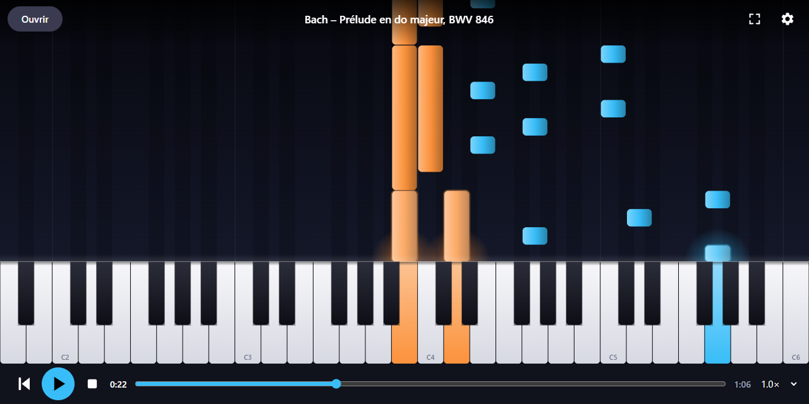
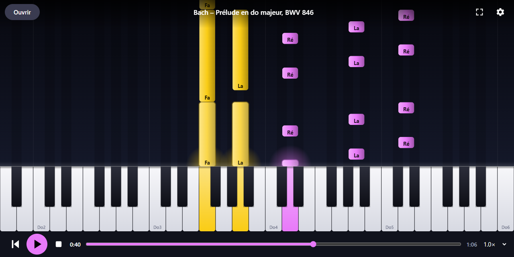
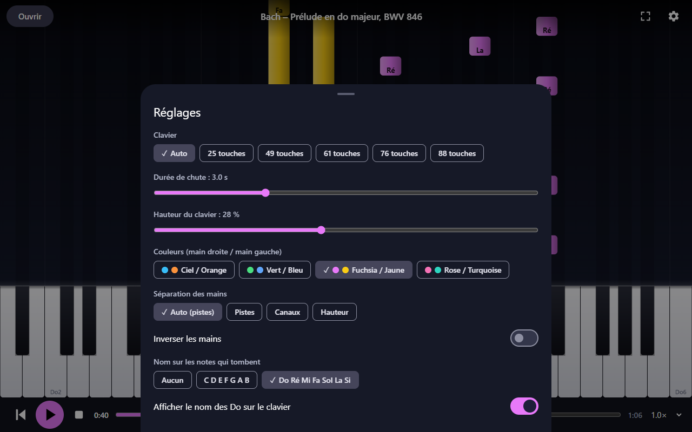
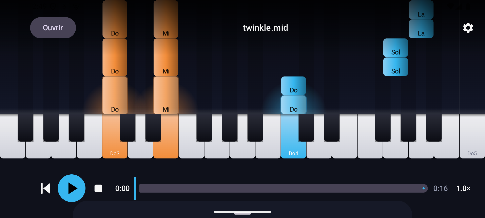

<div align="center">


# MIDI Piano Player

**Watch any MIDI file fall onto a piano keyboard.**

Open a `.mid` file, hit play, and see every note drop onto the keys that light
up as they sound. Left and right hands get their own colours, and note names
can be shown in letters (C D E) or solfège (Do Ré Mi). Runs in your browser,
or as an Android app.

[**Open the web app**](https://valtielchan.github.io/midi-piano-player/) &nbsp;·&nbsp;
[Download the Android APK](https://github.com/ValtielChan/midi-piano-player/releases/latest/download/midi-piano.apk)

[](LICENSE)
[](https://github.com/ValtielChan/midi-piano-player/actions/workflows/pages.yml)
[](https://github.com/ValtielChan/midi-piano-player/actions/workflows/android.yml)


</div>

---



No MIDI file at hand? The web app ships with a demo: the opening of Bach's
Prelude in C major (BWV 846), one click from the start screen.

## Features

- **Falling notes** with a glow when they hit the keyboard, and keys that
  light up in the colour of the hand playing them
- **Left / right hand colours**, split automatically by track, by channel or by
  pitch (with an adjustable split note), and swappable
- **Note names** on the falling notes, in letters (`C D E F G A B`) or solfège
  (`Do Ré Mi Fa Sol La Si`), or none at all
- **Transport**: play, pause, stop, back to start, a timeline you can scrub,
  and speed from 0.5× to 2×
- **Keyboard size**: auto (fitted to the piece), 25, 49, 61, 76 or 88 keys
- **View size**: fall duration from 1 to 8 seconds, keyboard height from 15 to
  45 % of the screen
- **Four colour palettes**, settings remembered, last file reopened on launch
- Tap the visual to hide the controls and keep only the piano

The interface is in French.

| Note names in solfège | Settings |
|:--:|:--:|
|  |  |

## Web app

[valtielchan.github.io/midi-piano-player](https://valtielchan.github.io/midi-piano-player/)

Plain HTML, CSS and JavaScript: no framework, no build step, no backend. Your
MIDI file is read by the browser and never uploaded anywhere.

- Open a file with the **Ouvrir** button, or drag and drop it onto the page
- The fullscreen button also locks landscape on Android phones
- The screen stays awake while a piece is playing

| Key | Action |
|:--:|---|
| `Space` | Play / pause |
| `Home` | Back to start |
| `←` `→` | Jump 5 seconds back / forward |
| `F` | Fullscreen |
| `O` | Open a file |

**Sound.** Browsers have no built-in General MIDI synth, so the app plays
sampled instruments from the [FluidR3_GM](https://github.com/gleitz/midi-js-soundfonts)
soundfont, fetched on demand: about 2.6 MB for the piano, then only the
instruments the piece uses. It needs a connection the first time. Drum tracks
and pitch bend are not played on the web; the Android app plays both.

## Android app

[**Download midi-piano.apk**](https://github.com/ValtielChan/midi-piano-player/releases/latest/download/midi-piano.apk) (Android 8.0 or later)



The app is not on the Play Store, so you install it by sideloading:

1. Download the APK on your phone.
2. Open it, and allow your browser or file manager to install unknown apps
   when Android asks.
3. Launch **MIDI Piano** and open a MIDI file from your phone. You can also
   open `.mid` files straight from a file manager.

The APK is signed with a debug key, so Android may show a warning, and an
update needs the previous version uninstalled first. The app is landscape only,
and plays through Android's built-in General MIDI synthesizer, drums included.

## Build from source

**Web app**: serve the `web/` folder with any static server, for example:

```bash
cd web
python -m http.server 8000   # http://localhost:8000
node test-midi.js            # MIDI parser test
```

**Android app**: needs JDK 17 and the Android SDK (platform 35).

```bash
./gradlew testDebugUnitTest assembleRelease
# APK in app/build/outputs/apk/release/app-release.apk
```

Every push to `main` runs both test suites, builds the APK, and deploys `web/`
to GitHub Pages ([pages.yml](.github/workflows/pages.yml),
[android.yml](.github/workflows/android.yml)).

## Project layout

```
web/                     Web app, deployed as is
├── index.html           Markup and styles
├── app.js               Rendering (canvas), UI, settings
├── audio.js             Sampled GM synth and sequencer (Web Audio)
├── midi.js              Standard MIDI File parser
├── test-midi.js         Parser test (node)
└── demo.mid             Bach, Prelude in C major BWV 846 (public domain)

app/src/main/java/com/fabien/midipiano/
├── MainActivity.kt      Jetpack Compose UI, transport, settings sheet
├── PianoCanvas.kt       Falling notes and keyboard rendering
├── Player.kt            Sequencer driving the Android GM synth
├── MidiFile.kt          Standard MIDI File parser, hand detection
└── Settings.kt          Settings, palettes, note names
```

## Credits

- [FluidR3_GM](https://github.com/gleitz/midi-js-soundfonts) soundfont by Frank
  Wen, converted for the web by Benjamin Gleitzman (web app sound)
- [MidiDriver](https://github.com/billthefarmer/mididriver) by Bill Farmer,
  which exposes Android's Sonivox synthesizer (Android app sound)

## License

[MIT](LICENSE) © Fabien Boco
